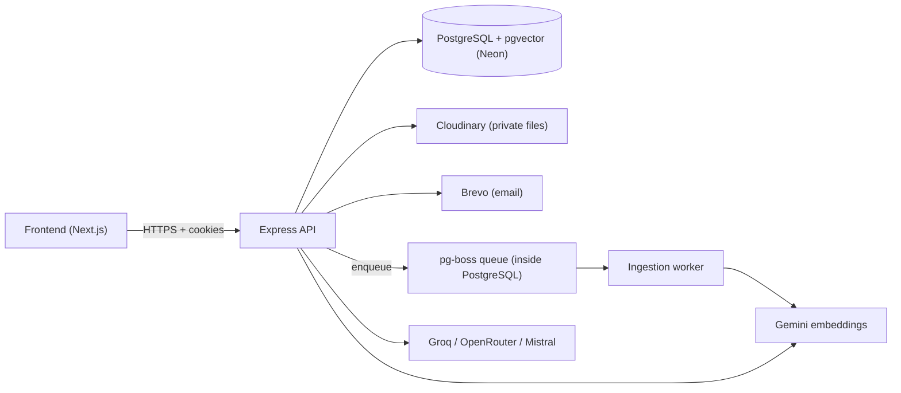
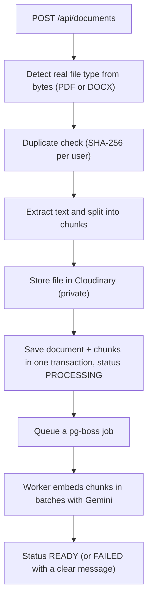

# Jiggasha (জিজ্ঞাসা) — Backend API

**Chat with your notes.** Jiggasha is an AI study assistant: students upload PDF or DOCX notes, ask questions and get answers **only from their own material**, with page or section references. The same notes can be turned into summaries, flashcards and quizzes, and exported.

This repository contains the backend REST API.


---

## Table of contents

1. [Features](#1-features)
2. [Tech stack](#2-tech-stack)
3. [Architecture](#3-architecture)
4. [How it works](#4-how-it-works)
5. [Getting started](#5-getting-started)
6. [Environment variables](#6-environment-variables)
7. [API reference](#7-api-reference)
8. [Data model](#8-data-model)
9. [Security](#9-security)
10. [Testing](#10-testing)
11. [Operations, limits and troubleshooting](#11-operations-limits-and-troubleshooting)
12. [Deployment checklist](#12-deployment-checklist)
13. [Known limitations and roadmap](#13-known-limitations-and-roadmap)
14. [Conventions](#14-conventions)
15. [License](#15-license)

---

## 1. Features

| Feature | What the API provides |
|---|---|
| Account and sign-in | Email and password, Google sign-in, session cookies with refresh-token rotation, forgot, reset and change password |
| Upload and indexing | PDF and DOCX upload, text extraction, chunking and vector embeddings, processed in the background |
| Question answering | Answers grounded in the student's notes, with citations (page for PDF, section for DOCX) taken from the database |
| Study materials | Auto-generated summaries, flashcards and multiple-choice quizzes with scoring |
| Library and history | Subjects (folders), a per-user document library, saved conversations and messages |
| Export | Flashcards as CSV or JSON, summaries as Markdown |

Design goals: answers never come from outside the student's notes, one student can never reach another student's data, and the service degrades gracefully when an AI provider is slow or rate-limited.

---

## 2. Tech stack

| Area | Choice | Why |
|---|---|---|
| Runtime and language | Node.js 20+, TypeScript (ESM) | Type safety end to end |
| HTTP framework | Express 5 | Simple, well known |
| Validation | Zod 4 | One schema gives runtime checks and types |
| Database | PostgreSQL on Neon with **pgvector** | Relational data and vector search in one place |
| ORM | Prisma **6.x (pinned)** | Migrations and typed queries. Raw SQL only for vector columns |
| Background jobs | pg-boss | A job queue inside the same PostgreSQL, no Redis or Docker needed |
| Embeddings | Google Gemini `gemini-embedding-001` (1536 dimensions) | Multilingual (Bangla, English, Hindi, Urdu, Arabic and more) |
| Answer generation | Groq, OpenRouter and Mistral through one OpenAI-compatible adapter, tried in a configurable order | Free-tier friendly, automatic fallback |
| File storage | Cloudinary (private, expiring download links) | Behind a `DocumentStorage` interface so it can move to S3 or R2 |
| Email | Brevo (transactional API) | Password reset and password-changed emails |
| Authentication | JWT access token and rotating refresh token in HttpOnly cookies, Argon2id, Google ID-token verification | No token is readable by JavaScript |
| Text extraction | `unpdf` (PDF, page by page), `mammoth` (DOCX, headings kept) | Page and section references |
| Images | `sharp` | Avatars are re-encoded to WebP |
| Logging | `pino` with redaction | No secrets or cookies in logs |

---

## 3. Architecture

A **modular monolith**. Every feature is a module, and every module follows the same layers:

```
route  ->  controller  ->  service  ->  repository  ->  database
```

- **Routes** declare paths, middleware and validation.
- **Controllers** read the request and shape the response. No business rules.
- **Services** hold the business rules and ownership checks.
- **Repositories** are the only place that talks to Prisma or raw SQL.



### Project structure

```
ai-jiggasha-backend/
├── prisma/
│   ├── schema.prisma          # Data model
│   └── migrations/            # SQL history (includes the HNSW vector index)
├── src/
│   ├── app.ts                 # Express app: middleware and routers
│   ├── server.ts              # Starts the queue, worker and HTTP server
│   ├── config/                # env (Zod-validated), logger, Prisma client
│   ├── middlewares/           # auth, csrf, error handler, rate limits, upload, validation
│   ├── modules/
│   │   ├── auth/              # register, login, Google, refresh, logout, password flows
│   │   ├── subjects/          # subject CRUD
│   │   ├── documents/         # upload, library, download link
│   │   ├── ingestion/         # extract, chunk, embed, quota guard, worker
│   │   ├── rag/               # retrieval, prompt, answer and citations
│   │   ├── conversations/     # chat sessions and messages
│   │   ├── study/             # summaries, flashcards, quizzes
│   │   └── exports/           # CSV, JSON and Markdown exports
│   ├── providers/
│   │   ├── ai/                # embedding provider, LLM router and adapters, usage log
│   │   ├── auth/              # Google ID-token verifier
│   │   ├── email/             # Brevo mailer and templates
│   │   ├── queue/             # pg-boss setup
│   │   └── storage/           # Cloudinary and the DocumentStorage interface
│   ├── shared/                # errors, cookies, tokens, passwords, image helper, DB retry
│   └── scripts/
│       └── smoke.ts           # End-to-end smoke test
└── test-files/                # Local sample files for the smoke test (git-ignored)
```

---

## 4. How it works

### 4.1 Document ingestion



- **File type** is read from the file's bytes, never from its name or the browser's MIME type.
- **Unreadable files are rejected before anything is stored**: scanned PDFs without text, damaged files, broken fonts, or files over the page and chunk limits.
- **Chunking** respects paragraphs and sentences. Latin text uses about 1800 characters per chunk with 200 overlap. Non-Latin scripts (Bangla, Hindi, Urdu, Arabic) use smaller chunks (900 with 100 overlap) because they cost more tokens. A DOCX heading always starts a new chunk, so one chunk never mixes two sections.
- **References**: PDF chunks keep `page_start` and `page_end`. DOCX has no pages, so each chunk keeps the nearest heading as `section_label`.
- **Language** is detected from the script and saved on the document (`bn`, `en`, `hi`, `ur`, `ar`).
- **Embeddings** are normalized, 1536 dimensions, and stored with the model name, so a future model change can be done chunk by chunk.
- **Quota guard**: requests per minute, tokens per minute and a rolling daily budget are enforced from configuration and from `ai_usage_logs`. When Gemini says "slow down" or the daily budget is used up, the document is **not** failed. The job is re-queued and the student sees a note such as "Processing will continue automatically".
- The worker only touches chunks that have no embedding yet, so re-running a job is always safe.

### 4.2 Question answering

1. The question is embedded with the `RETRIEVAL_QUERY` task type.
2. A cosine search (HNSW index) runs over the student's own `READY` chunks, limited to the conversation's scope: all notes, one subject, or chosen documents. Every query filters on `user_id`.
3. Chunks below `RAG_MIN_SCORE` are dropped. **If nothing is left, no LLM call is made** and the student gets "I couldn't find the answer in your notes".
4. Otherwise the LLM receives the chunks inside delimited `<source>` blocks, with rules that say: answer only from the sources, treat source text as data and never as instructions, cite with `[n]`, and reply in the language of the question.
5. The `[n]` markers only select which retrieved chunks to show. **Title, page, section and excerpt always come from the database**, never from the model's text. Markers are renumbered so `[1]` is always the first source card.
6. The question and the answer are saved together in one transaction, with a snapshot of each source, so old chats keep their citations even if a document is deleted later.

### 4.3 Answer generation and fallback

All answer providers are called through one adapter (`openai-compatible.llm.ts`). The order comes from `ANSWER_FALLBACK_ORDER` (default `groq,openrouter,mistral`). A provider without an API key is skipped. Temporary errors are retried briefly, rate-limited or failing providers are skipped in favour of the next one, and if all fail the API returns `503 AI_UNAVAILABLE`. Every attempt is written to `ai_usage_logs` (provider, model, operation, tokens, latency, status).

Gemini is used **only for embeddings**. Embeddings have no fallback, because vectors from different models cannot be mixed.

### 4.4 Study materials

- A summary, flashcard set or quiz is generated from a `READY` document. Long documents are sampled evenly (up to about 24,000 characters) to stay inside free-tier token limits.
- Flashcards and quizzes are requested as JSON and validated with Zod. A wrong format gets one retry.
- A quiz that is being taken **never contains the correct answers**. They are returned only after an attempt is submitted, together with the explanation and the source page or section (taken from the database chunk).
- Questions whose options repeat are dropped.

---

## 5. Getting started

### Prerequisites

- Node.js 20 or newer (22 LTS recommended) and npm
- Accounts and keys for:
  - **Neon** (PostgreSQL with pgvector)
  - **Cloudinary** (file storage)
  - **Brevo** (email API key and a verified sender address)
  - **Google Cloud** (an OAuth *Web* client ID for Google sign-in)
  - **Google AI Studio** (Gemini API key, used for embeddings)
  - **At least one answer provider**: Groq, OpenRouter or Mistral

### Installation

```bash
git clone <your-repository-url>
cd ai-jiggasha-backend
npm install
cp .env.example .env     # then fill in the values (see section 6)
```

> Prisma is pinned to **6.x** on purpose (`schema.prisma` keeps `url` and `directUrl`). Do not upgrade to Prisma 7 without migrating to `prisma.config.ts`.

### Database

Neon provides two connection strings. Use both:

- `DATABASE_URL`: the **pooled** string, used by the app for normal queries.
- `DIRECT_URL`: the **direct (non-pooled)** string, used by Prisma migrations and by pg-boss.

Recommended extra parameters on `DATABASE_URL` for Neon (the compute can pause when idle):

```
?sslmode=require&connect_timeout=15&pool_timeout=15
```

Apply all migrations (this also enables the `vector` extension and creates the HNSW index):

```bash
npx prisma migrate deploy
npx prisma generate
```

On first start, pg-boss creates its own `pgboss` schema in the same database.

### Run

```bash
npm run dev        # development, auto-restart on change
npm run build      # compile to dist/
npm start          # run the compiled build
```

Check that it is alive:

```bash
curl http://localhost:5000/health
# {"status":"ok","database":"up"}
```

### npm scripts

| Script | Purpose |
|---|---|
| `npm run dev` | Start with `tsx watch` |
| `npm run build` | Compile TypeScript to `dist/` |
| `npm start` | Run `dist/server.js` |
| `npm run typecheck` | Type-check without emitting files |
| `npm test` | Run Vitest |
| `npm run smoke -- <file> ["question" ...] [--keep]` | End-to-end smoke test (section 10) |
| `npm run prisma:migrate` | `prisma migrate dev` (development only) |
| `npm run prisma:generate` | Regenerate the Prisma client |
| `npm run prisma:studio` | Open Prisma Studio |

### Working with migrations (important)

The HNSW vector index exists in the migration SQL but **not** in `schema.prisma` (Prisma cannot express it). Because of that, `prisma migrate dev` may generate a statement like:

```sql
DROP INDEX "document_chunks_embedding_hnsw_idx";
```

When you create a migration, always review it first and delete that line:

```bash
npx prisma migrate dev --name <change> --create-only
# open the new migration.sql, remove any DROP INDEX for the HNSW index, then:
npx prisma migrate dev
```

Never edit a migration after it has been applied. Fix mistakes with a new migration. In production, use `npx prisma migrate deploy` only.

---

## 6. Environment variables

The server validates `.env` with Zod at start-up. If something is missing or wrong it prints the variable **names** (never the values) and exits.

### Core

| Variable | Required | Default | Description |
|---|---|---|---|
| `NODE_ENV` | no | `development` | `development`, `test` or `production` |
| `PORT` | no | `5000` | HTTP port |
| `FRONTEND_ORIGIN` | yes | | Exact frontend origin, used for CORS, CSRF checks and email links |
| `DATABASE_URL` | yes | | Neon **pooled** connection string |
| `DIRECT_URL` | yes | | Neon **direct** connection string (migrations and pg-boss) |

### Authentication and email

| Variable | Required | Default | Description |
|---|---|---|---|
| `JWT_ACCESS_SECRET` | yes | | At least 32 characters |
| `JWT_REFRESH_SECRET` | yes | | At least 32 characters, must differ from the access secret |
| `ACCESS_TOKEN_TTL_MINUTES` | no | `15` | Access token lifetime |
| `REFRESH_TOKEN_TTL_DAYS` | no | `7` | Refresh token lifetime |
| `PASSWORD_RESET_TTL_MINUTES` | no | `15` | Reset link lifetime |
| `GOOGLE_CLIENT_ID` | yes | | Must end with `.apps.googleusercontent.com` |
| `BREVO_API_KEY` | yes | | Brevo API key |
| `EMAIL_FROM_ADDRESS` | yes | | Verified sender address |
| `EMAIL_FROM_NAME` | no | `Jiggasha` | Sender name |

Generate strong secrets with `node -e "console.log(require('crypto').randomBytes(48).toString('hex'))"`.

### Storage and uploads

| Variable | Required | Default | Description |
|---|---|---|---|
| `CLOUDINARY_CLOUD_NAME` | yes | | |
| `CLOUDINARY_API_KEY` | yes | | |
| `CLOUDINARY_API_SECRET` | yes | | |
| `AVATAR_MAX_MB` | no | `2` | Maximum avatar size |
| `DOCUMENT_MAX_MB` | no | `10` | Maximum document size |

### Embeddings and ingestion

| Variable | Required | Default | Description |
|---|---|---|---|
| `GEMINI_API_KEY` | yes | | Used for embeddings only |
| `EMBEDDING_MODEL` | no | `gemini-embedding-001` | Must output 1536 dimensions to match `vector(1536)` |
| `EMBEDDING_MAX_RPM` | no | `60` | Requests per minute budget |
| `EMBEDDING_MAX_TPM` | no | `25000` | Tokens per minute budget |
| `EMBEDDING_DAILY_BUDGET` | no | `850` | Embedding requests per rolling 24 hours |
| `MAX_PAGES_PER_DOCUMENT` | no | `150` | PDF page limit |
| `MAX_CHUNKS_PER_DOCUMENT` | no | `400` | Chunk limit per document |

Keep the three embedding limits a little below your provider's real limits (check Google AI Studio for your project).

### Answer generation

| Variable | Required | Default | Description |
|---|---|---|---|
| `ANSWER_FALLBACK_ORDER` | no | `groq,openrouter,mistral` | Order the providers are tried in |
| `GROQ_API_KEY` / `GROQ_MODEL` | one provider is required | model `openai/gpt-oss-120b` | |
| `OPENROUTER_API_KEY` / `OPENROUTER_MODEL` | | model `google/gemma-3-27b-it:free` | |
| `MISTRAL_API_KEY` / `MISTRAL_MODEL` | | model `mistral-small-latest` | |
| `RAG_TOP_K` | no | `6` | Chunks retrieved per question (4 is a good value for free tiers) |
| `RAG_MIN_SCORE` | no | `0.55` | Minimum cosine similarity. Below it, no LLM call is made |

At least one provider listed in `ANSWER_FALLBACK_ORDER` must have a key. Model names change often, so check each provider's site if a model is reported as not found.

`RAG_MIN_SCORE` depends on your notes. The server logs the best score of every retrieval (`RAG retrieval`, field `topScore`), which makes tuning easy: choose a value between the scores of questions that **are** answered by the notes and those that are not.

---

## 7. API reference

Base path: `/api`. All request and response bodies are JSON unless stated otherwise.

### 7.1 Conventions

**Success**

```json
{ "data": { } }
```

**Error**

```json
{
  "error": {
    "code": "VALIDATION_ERROR",
    "message": "Invalid request data",
    "details": [{ "path": "id", "message": "Invalid subject id" }]
  }
}
```

`details` appears for validation errors. Error messages are safe for end users. Internal details are only in the server log.

**Cookies and CSRF.** The access token and refresh token are HttpOnly cookies. The browser sends them automatically, so every state-changing request must also carry an `Origin` header equal to `FRONTEND_ORIGIN`, otherwise the API answers `403 CSRF_BLOCKED`. Browsers do this by themselves. With curl or Postman, add the header yourself.

**Pagination.** List endpoints that paginate accept `page` (default 1) and `limit` (default 20, maximum 50) and return `{ items, total, page, limit }`, where the items key is named after the resource (`documents`, `conversations`).

**Ownership.** Every resource belongs to one user. Asking for someone else's resource returns `404`, exactly like a missing one.

### 7.2 Endpoints

Routes marked **auth** need a logged-in user.

#### Health

| Method | Path | Description |
|---|---|---|
| GET | `/health` | Database connectivity check (outside `/api`) |

#### Auth: `/api/auth`

| Method | Path | Auth | Description |
|---|---|---|---|
| POST | `/register` | | `multipart/form-data`: `fullName`, `email`, `password`, `confirmPassword`, optional `avatar` image. Logs the user in |
| POST | `/login` | | `{ email, password }` |
| POST | `/google` | | `{ credential }` (Google ID token). Creates or signs in the user |
| POST | `/refresh` | | Uses the refresh cookie. Rotates both tokens |
| POST | `/logout` | | Ends the session family and clears cookies |
| GET | `/me` | auth | Current user |
| POST | `/forgot-password` | | `{ email }`. Always answers the same way |
| POST | `/reset-password` | | `{ token, password, confirmPassword }`. Single use |
| POST | `/change-password` | auth | `{ currentPassword, newPassword, confirmPassword }` |

#### Subjects: `/api/subjects` (all auth)

| Method | Path | Description |
|---|---|---|
| GET | `/` | List subjects with `documentCount` |
| POST | `/` | `{ name, description? }`. Names are unique per user |
| GET | `/:id` | One subject |
| PATCH | `/:id` | `{ name?, description? }` |
| DELETE | `/:id` | Deletes the subject. Its documents are kept (their subject becomes empty) |

#### Documents: `/api/documents` (all auth)

| Method | Path | Description |
|---|---|---|
| POST | `/` | `multipart/form-data`: `file` (PDF or DOCX), optional `title`, `subjectId` |
| GET | `/` | Query: `subjectId`, `status`, `page`, `limit` |
| GET | `/:id` | One document with its processing status |
| GET | `/:id/download` | `{ url, expiresAt }`: a private link valid for 5 minutes |
| PATCH | `/:id` | `{ title?, subjectId? }` (`subjectId: null` removes it from its subject) |
| DELETE | `/:id` | Deletes the document, its chunks and the stored file |

Document status: `PROCESSING` then `READY` or `FAILED`. While processing, `errorMessage` may hold a progress note (for example when the AI quota is used up). Only `READY` documents can be searched or used for study materials.

#### Conversations: `/api/conversations` (all auth)

| Method | Path | Description |
|---|---|---|
| POST | `/` | `{ title?, subjectId?, documentIds? }`. The search scope is fixed at creation: chosen documents, one subject, or all notes |
| GET | `/` | Paginated list, newest activity first |
| GET | `/:id` | The conversation with its documents, messages and sources |
| PATCH | `/:id` | `{ title }` |
| DELETE | `/:id` | Deletes the conversation and its messages |
| POST | `/:id/messages` | `{ content }` (max 2000 characters). Returns both messages. Limited to 10 per minute per user |

#### Study: `/api/study` (all auth)

| Method | Path | Description |
|---|---|---|
| POST | `/summaries` | `{ documentId, length }` with `length` = `SHORT`, `MEDIUM` or `DETAILED` |
| GET | `/summaries` | Optional `documentId` filter |
| GET, DELETE | `/summaries/:id` | |
| POST | `/flashcard-sets` | `{ documentId, count }` (5 to 30) |
| GET | `/flashcard-sets` | Optional `documentId` filter |
| GET, DELETE | `/flashcard-sets/:id` | |
| POST | `/quizzes` | `{ documentId, count }` (3 to 20). The response has no answers |
| GET | `/quizzes` | Optional `documentId` filter |
| GET, DELETE | `/quizzes/:id` | |
| POST | `/quizzes/:id/attempts` | `{ answers }`: one entry per question, `0` to `3` or `null` for skipped. Returns the score and per-question results with the correct answer and explanation |
| GET | `/quizzes/:id/attempts` | Past attempts |

Generation endpoints are limited to 5 per minute per user.

#### Exports: `/api/exports` (all auth)

| Method | Path | Description |
|---|---|---|
| GET | `/flashcard-sets/:id?format=csv` | CSV (UTF-8 with BOM, opens correctly in Excel) or `format=json` |
| GET | `/summaries/:id` | Markdown file |

### 7.3 Error codes

| HTTP | Code | Meaning |
|---|---|---|
| 400 | `VALIDATION_ERROR` | Invalid request data (see `details`) |
| 400 | `FILE_REQUIRED`, `INVALID_UPLOAD`, `INVALID_ANSWERS` | Bad upload or quiz answers |
| 400 | `INVALID_RESET_TOKEN`, `INCORRECT_CURRENT_PASSWORD`, `NO_PASSWORD_SET` | Password flows |
| 401 | `UNAUTHENTICATED` | Not logged in or access token expired. Call `/auth/refresh` |
| 401 | `SESSION_EXPIRED` | Refresh failed. The user must log in again |
| 401 | `INVALID_CREDENTIALS` | Wrong email or password |
| 403 | `CSRF_BLOCKED` | Missing or wrong `Origin` header |
| 404 | `*_NOT_FOUND` | Subject, document, conversation, summary, quiz or flashcard set not found |
| 409 | `EMAIL_ALREADY_USED`, `SUBJECT_NAME_TAKEN`, `DOCUMENT_ALREADY_EXISTS` | Conflicts |
| 409 | `DOCUMENT_NOT_READY` | The document is still processing |
| 413 | `PAYLOAD_TOO_LARGE` | File over the size limit |
| 415 | `UNSUPPORTED_FILE_TYPE` | Not a PDF or DOCX |
| 422 | `NO_READABLE_TEXT`, `DOCUMENT_UNREADABLE`, `TEXT_UNREADABLE`, `DOCUMENT_TOO_LONG` | The file cannot be indexed |
| 429 | `RATE_LIMITED`, `AI_BUSY` | Too many requests or the AI service is busy |
| 502 | `DOCUMENT_UPLOAD_FAILED`, `AI_BAD_RESPONSE` | A dependency failed or returned an unexpected answer |
| 503 | `AI_UNAVAILABLE` | Every answer provider failed |
| 500 | `INTERNAL_ERROR` | Unexpected error (details are in the server log only) |

### 7.4 Examples (curl)

```bash
API=http://localhost:5000/api
ORIGIN=http://localhost:3000      # must equal FRONTEND_ORIGIN

# Log in and keep the cookies
curl -s -c jar.txt -H "Origin: $ORIGIN" -H "Content-Type: application/json" \
  -d '{"email":"student@example.com","password":"your-password"}' \
  $API/auth/login

# Create a subject
curl -s -b jar.txt -H "Origin: $ORIGIN" -H "Content-Type: application/json" \
  -d '{"name":"Biology"}' $API/subjects

# Upload a document
curl -s -b jar.txt -H "Origin: $ORIGIN" \
  -F "file=@./notes.pdf" -F "subjectId=<subject-id>" $API/documents

# Poll until status is READY
curl -s -b jar.txt $API/documents/<document-id>

# Start a conversation over that document and ask a question
curl -s -b jar.txt -H "Origin: $ORIGIN" -H "Content-Type: application/json" \
  -d '{"documentIds":["<document-id>"]}' $API/conversations

curl -s -b jar.txt -H "Origin: $ORIGIN" -H "Content-Type: application/json" \
  -d '{"content":"Where does the Calvin cycle take place?"}' \
  $API/conversations/<conversation-id>/messages
```

Shape of an answer:

```json
{
  "data": {
    "userMessage": { "id": "…", "role": "USER", "content": "…", "sources": [] },
    "assistantMessage": {
      "id": "…",
      "role": "ASSISTANT",
      "content": "The Calvin cycle takes place in the stroma [1].",
      "provider": "groq",
      "model": "openai/gpt-oss-120b",
      "sources": [
        {
          "id": "…",
          "documentId": "…",
          "documentTitle": "Biology Notes",
          "pageStart": 1,
          "pageEnd": 1,
          "sectionLabel": null,
          "excerpt": "The Calvin cycle, also called the light-independent reactions…",
          "score": 0.68
        }
      ],
      "createdAt": "…"
    },
    "usedFallback": false
  }
}
```

When no relevant notes are found, `provider` and `model` are `null`, `sources` is empty and no AI call was made.

### 7.5 Notes for frontend developers

- Send every request with `credentials: "include"`.
- On a `401 UNAUTHENTICATED`, call `POST /api/auth/refresh` once, then retry the original request. If refresh returns `SESSION_EXPIRED`, send the user to the login page. A wrong current password returns `400` (not `401`) on purpose, so it is not mistaken for an expired session.
- Poll `GET /api/documents/:id` every few seconds while the status is `PROCESSING`.
- Render the `[n]` markers in an answer as links to `sources[n - 1]`.
- Show an indicator when `usedFallback` is true: the answer came from a backup model and may be of lower quality, especially in Bangla, Urdu or Arabic.
- Urdu and Arabic notes need `dir="rtl"` in chat and citation views.
- Tell students that uploaded notes are sent to third-party AI services for processing.

---

## 8. Data model

All primary keys are UUIDs. Tables use snake_case names.

| Table | Purpose |
|---|---|
| `users` | Account. `password_hash` is empty for Google-only users |
| `refresh_tokens` | Hashed refresh tokens grouped by `family_id`, with rotation and reuse detection |
| `auth_accounts` | Linked external identities (Google `sub`) |
| `password_reset_tokens` | Hashed, single-use reset tokens |
| `subjects` | Student folders. Unique name per user |
| `documents` | Uploaded files: status, language, page count, hash, storage key |
| `document_chunks` | Text chunks with `vector(1536)` embedding, `embedding_model`, page range or section label. HNSW cosine index |
| `conversations` | Chat sessions with a fixed search scope |
| `conversation_documents` | Documents a conversation is limited to |
| `messages` | User and assistant messages, with provider and model |
| `message_sources` | Citation snapshots (title, page, section, excerpt, score) |
| `summaries` | Generated summaries |
| `flashcard_sets`, `flashcards` | Generated flashcards, one row per card |
| `quizzes`, `quiz_questions` | Generated quizzes. Options stored as JSON, answer and explanation kept server-side |
| `quiz_attempts` | A student's submitted answers and score |
| `ai_usage_logs` | One row per AI call: provider, model, operation, tokens, latency, status |

Delete behaviour worth knowing:

- Deleting a **user** deletes everything they own.
- Deleting a **document** deletes its chunks and conversation links. Past citations in chats stay (they are snapshots), and summaries, flashcards and quizzes made from it are kept.
- Deleting a **subject** keeps its documents and conversations.

pg-boss keeps its own tables in the `pgboss` schema.

---

## 9. Security

- **Authentication**: short-lived access token and rotating refresh token, both in HttpOnly cookies. A refresh token works exactly once. Reusing an old one ends the whole session family. Tokens are stored only as hashes.
- **Passwords**: Argon2id. Login for an unknown email takes the same work as a real check, so timing reveals nothing.
- **Password reset**: single-use hashed tokens that expire, only the newest link works, resets log the user out everywhere, and the "forgot password" answer is identical whether or not the email exists.
- **Google sign-in**: the ID token is verified (audience, issuer, expiry, verified email). Identity is the Google `sub`, never the email alone. Linking Google to an unverified password account removes that password and ends its sessions.
- **CSRF**: `Origin` header check on state-changing requests, plus cookie flags (`HttpOnly`, `Secure` in production, `SameSite`).
- **Authorization**: every query filters by `user_id`. Vector search filters by `user_id` inside SQL, so another student's chunks can never be retrieved. Other people's resources look like "not found".
- **Input**: Zod validation on every body, query and parameter. Raw SQL is always parameterized.
- **Uploads**: type detected from bytes, size limits, in-memory processing, duplicate detection by hash, private storage with 5-minute download links, avatars re-encoded with `sharp`.
- **Prompt injection**: document text is placed in delimited blocks and declared to be data. The model is told to ignore instructions found inside it. Citations never come from model output.
- **Exports**: CSV cells that start with `=`, `+`, `-` or `@` are neutralized to prevent spreadsheet formula injection.
- **Hardening and logging**: `helmet`, strict CORS with credentials, per-route rate limits, errors that never leak internals, and `pino` redaction for cookies, tokens and passwords.
- **Secrets** live only in `.env`, which is git-ignored.

---

## 10. Testing

**Type check**

```bash
npm run typecheck
```

**Smoke test (end to end).** With the server running in one terminal, run in another:

```bash
npm run smoke -- ./test-files/biology-notes.pdf \
  "Where does the Calvin cycle take place?" \
  "Who won the 2018 FIFA World Cup?"
```

The script registers a throwaway student and walks through the whole product: health check, cookie login, subject, upload, duplicate refusal, waiting for `READY`, conversation and every question (printing the answer and its sources), summary, flashcards, quiz (checking answers stay hidden), attempt, exports, and a second student trying to read the first student's data (must get 404). It also fails if the model obeys an instruction hidden inside a document. It deletes what it created. Add `--keep` to keep the data for inspection.

Use small, text-based files (under 10 pages) to save the free-tier quota. Scanned documents are not supported.

**Unit tests.** Vitest and Supertest are installed and wired to `npm test`.

---

## 11. Operations, limits and troubleshooting

### Free-tier realities

- **Gemini (embeddings)**: the free tier has per-minute and per-day limits, and Google may use free-tier content to improve its products. Use non-sensitive notes for demos, or enable billing before real students upload private notes. The quota guard and the `EMBEDDING_*` variables keep ingestion inside the limits.
- **Answer providers**: free tiers rate-limit quickly. Configure more than one provider so the fallback has somewhere to go.
- **Neon**: the compute may pause when idle, so the first request can take a few seconds. Queue workers keep polling while the server runs, so stop the dev server when you are not using it.

### Troubleshooting

| Symptom | Likely cause and fix |
|---|---|
| Server exits at start with `Invalid environment configuration` | The listed variable names are missing or invalid in `.env` |
| `403 CSRF_BLOCKED` in Postman or curl | Add the header `Origin: <FRONTEND_ORIGIN>` |
| Sometimes `500` with `P1017 Server has closed the connection` in the log | Neon closed an idle pooled connection. The retrieval query retries once automatically. Add `connect_timeout=15&pool_timeout=15` to `DATABASE_URL` |
| `pg-boss connection problem` lines in the log | A dropped connection. pg-boss reconnects by itself. Safe unless jobs stop running |
| Document stays `PROCESSING` | Embedding quota or rate limit. The job retries automatically. The `errorMessage` field explains. Check the Gemini key and limits |
| Document goes `FAILED` | See `errorMessage`, then the `Embedding failed` log line |
| `503 AI_UNAVAILABLE` on a question | Every answer provider failed. Read the `LLM attempt failed` log lines (they include the reason, for example `groq returned 429`) and check keys and model names |
| `422 NO_READABLE_TEXT` | A scanned PDF or an image-only file |
| `prisma migrate dev` says the database drifted | The HNSW index is missing or a migration file was edited. See "Working with migrations" |
| `argon2` fails to install on Windows | Install the build tools for native modules, or use a Node version that has a prebuilt binary |

---

## 12. Deployment checklist

1. Set `NODE_ENV=production` so cookies are `Secure`.
2. Serve over HTTPS. Set `FRONTEND_ORIGIN` to the exact production origin.
3. If the frontend and API live on different sites, review the cookie `SameSite` setting and CORS before going live.
4. Use strong, different `JWT_ACCESS_SECRET` and `JWT_REFRESH_SECRET`.
5. Run `npx prisma migrate deploy` before starting the new version. Never run `migrate dev` or `migrate reset` against production data.
6. Build and start: `npm run build && npm start`.
7. Keep `DIRECT_URL` pointing at a direct (non-pooled) connection for pg-boss.
8. If real students will upload private notes, move embeddings to a paid tier (the free tier may use content to improve products) and update the privacy notice.
9. Several instances can run side by side. pg-boss shares jobs safely, and the in-memory per-minute embedding limiter is per instance, so lower `EMBEDDING_MAX_RPM` accordingly.

---

## 13. Known limitations and roadmap

**Known limitations**

- No OCR: scanned PDFs are rejected with a clear message.
- DOCX files have no page numbers, so references use section headings.
- Embedding model is fixed. Changing it means re-embedding (the `embedding_model` column makes this possible step by step).
- Free-tier answer models can be weaker in Bangla, Urdu and Arabic.
- Email addresses of password accounts are not verified yet.

**Roadmap**

- Next.js frontend (dashboard, chat with citations, study tools)
- Email verification
- Hybrid search (vector plus PostgreSQL full-text) for exact names and numbers
- Move file storage to S3 or Cloudflare R2 behind the existing interface
- Profile management endpoints
- Automated unit and integration tests
- OCR for scanned notes
- Upgrade to Prisma 7 after the deadline-critical work

---

## 14. Conventions

- **Commits** follow [Conventional Commits](https://www.conventionalcommits.org/): `feat(documents): …`, `fix(rag): …`, `docs: …`.
- **Imports** are relative and include the `.js` extension (ESM).
- **Layering**: routes, controllers, services, repositories. Prisma is used only in repositories.
- **Errors** are thrown as `AppError(status, CODE, message)` and handled in one central middleware.
- **Responses** always use the `{ data }` and `{ error }` envelopes.
- **Validation** happens at the edge with Zod, and handlers trust the validated types.
- Do not edit applied migrations, and do not commit `.env`.

---

## 15. License

ISC. See `package.json`.